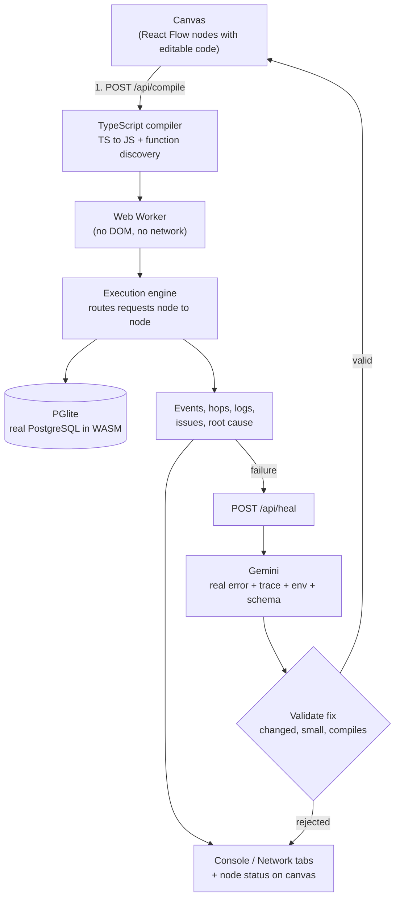
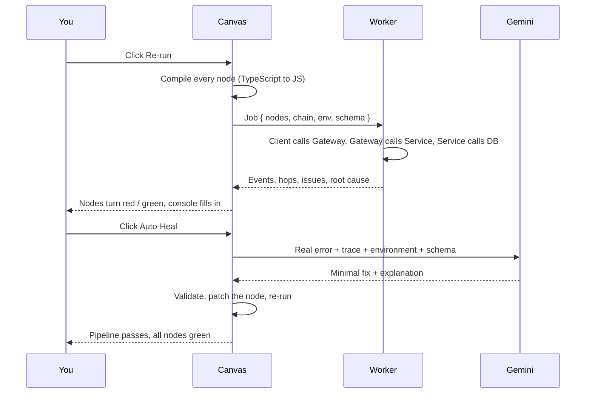

<div align="center">


# CanvasDoc

### Spatial Runtime & Self-Healing Debugger

**Trace a request across microservices on a canvas, find the real root cause, and let AI heal the failing node, then prove the fix by running it again.**

<br />


[Live Demo](#) · [Demo Video](#) · [Report a Bug](../../issues)

<br />

<!-- Replace with a real screenshot or GIF. Put the file in /docs and update the path. -->


</div>

---

## Table of Contents

- [The Problem](#the-problem)
- [The Solution](#the-solution)
- [Features](#features)
- [How It Works](#how-it-works)
- [Demo Scenario](#demo-scenario)
- [Tech Stack](#tech-stack)
- [Project Structure](#project-structure)
- [Getting Started](#getting-started)
- [Usage Guide](#usage-guide)
- [Design Decisions](#design-decisions)
- [Limitations](#limitations)
- [Troubleshooting](#troubleshooting)
- [Roadmap](#roadmap)
- [License](#license)

---

## The Problem

In a microservice architecture, a single user action travels through many services. When something breaks, the error you see is rarely the error that happened.

A `500` in the client might come from a gateway that proxied a payment service that crashed on a typo, two hops away from where you are looking. Developers end up jumping between logs, terminals and dashboards to reconstruct what happened.

Existing "AI debugging" tools make this worse in one way: they **guess**. They read code and speculate, without ever running it.

## The Solution

CanvasDoc puts the whole request path on **one canvas** and makes every box real:

- Your code is **actually executed**.
- Requests **actually travel** from node to node.
- The database is **actually PostgreSQL**.
- The AI fix is **verified by re-running the pipeline**, not just trusted.

> Real execution, real requests, real errors, then AI repair grounded in what really happened.

---

## Features

| | Feature | Description |
| :-: | --- | --- |
| 🧩 | **Spatial canvas** | Drag, resize and connect nodes (client, gateway, service, database) with React Flow. Each node holds editable code. |
| ⚡ | **Real execution** | TypeScript is compiled with the real TypeScript compiler and executed in a sandboxed Web Worker. |
| 🐘 | **Real PostgreSQL** | Database nodes run actual PostgreSQL compiled to WebAssembly (PGlite), entirely in the browser. |
| 🔎 | **Root-cause detection** | A failure that bubbles up through several services is traced back to the node where it started. |
| 📡 | **Network inspector** | See the method, path, headers, request body, response body, status and latency of every hop. |
| 🖥️ | **Live console** | A timestamped timeline of requests, responses, logs and issues, with failing nodes highlighted on the canvas. |
| 🩹 | **Auto-heal** | Gemini receives the real error, wire trace, environment and schema, and proposes the smallest possible fix. |
| ✅ | **Verified fixes** | Every AI fix is validated and the pipeline is re-run to prove it works. |
| 🌍 | **Editable environment** | HTTP client, payment provider, DB driver and error classes are plain code you can edit. |

---

## How It Works



### Request lifecycle



---

## Demo Scenario

The default canvas models a checkout flow:

```
Client (Next.js App)  →  API Gateway  →  Payment Service  →  PostgreSQL DB
```

1. The client sends `POST /pay` with a user, an amount and a bearer token.
2. The gateway checks authorization and forwards to the payment service.
3. The payment service charges the card, inserts a row into `transactions`, and responds.

**The bug:** the payment service calls `res.jsn(...)` instead of `res.json(...)`.

The database insert succeeds, but the failure surfaces as a `500` all the way back at the client. CanvasDoc shows the full trace, identifies the **Payment Service** as the root cause, and **Auto-Heal** fixes the typo and verifies it with a fresh run.

---

## Tech Stack

| Layer | Technology |
| --- | --- |
| Framework | [Next.js](https://nextjs.org/) (App Router), React, TypeScript |
| Styling | [Tailwind CSS v4](https://tailwindcss.com/) |
| Canvas | [React Flow](https://reactflow.dev/) (`@xyflow/react`) |
| Compilation | [TypeScript Compiler API](https://github.com/microsoft/TypeScript/wiki/Using-the-Compiler-API) |
| Sandboxed execution | Web Workers (ES module worker) |
| Database | [PGlite](https://pglite.dev/), PostgreSQL in WebAssembly |
| AI | [Google Gemini API](https://ai.google.dev/) with structured JSON output |
| Icons | [lucide-react](https://lucide.dev/) |

---

## Project Structure

```
canvasdoc/
├── app/
│   ├── api/
│   │   ├── compile/route.ts     # Compiles node TypeScript to JavaScript
│   │   └── heal/route.ts        # Validates input, calls the AI healer
│   ├── globals.css              # Global styles and theme tokens
│   ├── layout.tsx               # Root layout, fonts, metadata
│   └── page.tsx                 # Canvas, console, network and environment UI
├── components/
│   └── ServiceNode.tsx          # Resizable node card with live status and code editor
├── lib/
│   ├── ai.ts                    # Repair prompt, response parsing, fix validation
│   ├── compile.ts               # TS to JS, function discovery, diagnostics
│   ├── defaults.ts              # Default environment code and SQL schema
│   ├── gemini.ts                # Gemini client with timeout and model fallback
│   └── runtime.ts               # Worker client, shared types, timeout handling
└── public/
    ├── runtime-engine.js        # Execution engine (routing, tracing, root cause)
    └── runtime-worker.js        # Web Worker entry point
```

---

## Getting Started

### Prerequisites

- **Node.js** 18 or newer
- A **Gemini API key** from [Google AI Studio](https://aistudio.google.com/apikey) (only needed for Auto-Heal)

### Installation

```bash
# Clone the repository
git clone https://github.com/<your-username>/canvasdoc.git
cd canvasdoc

# Install dependencies
npm install
```

### Configuration

Create a `.env.local` file in the project root:

```bash
GEMINI_API_KEY=your_api_key_here

# Optional: try this model first. Otherwise the built-in list is used.
# GEMINI_MODEL=gemini-3.8-flash
```

> **Security:** never commit `.env.local`. The key is only used server-side in `/api/heal` and is never sent to the browser. When deploying, add `GEMINI_API_KEY` in your host's environment settings.

### Run

```bash
npm run dev
```

Open [http://localhost:3000](http://localhost:3000).

### Production build

```bash
npm run build
npm start
```

---

## Usage Guide

| Step | Action |
| :-: | --- |
| **1** | **Edit** any node's code directly on the canvas. Drag and resize nodes as you like. |
| **2** | Click **Re-run** to execute the full request chain. |
| **3** | **Inspect** the bottom panel: **Console** (timeline), **Network** (every hop), **Environment** (shared globals and SQL schema). |
| **4** | If a node fails, click **Auto-Heal Error**. The fix is applied and the pipeline is re-run automatically. |
| **5** | Click **Reset** to restore the default demo. |

### The environment

Everything outside your nodes is defined in the **Environment** tab as plain code. Every `export` becomes a global in all nodes:

| Global | Purpose |
| --- | --- |
| `api` | Axios-style HTTP client that talks to the next node and throws on 4xx/5xx |
| `forwardTo(service, req)` | Proxies a request to another service by name |
| `stripe` | Async payment provider stand-in |
| `db.query(params)` | Database driver that sends parameters to the next SQL node |
| `AuthError` | Example custom error class with a `401` status |

---

## Design Decisions

**Execution is sandboxed.** User code runs in a Web Worker with no DOM or network access. A 20 second timeout terminates the worker if code loops forever or a Promise never resolves.

**The engine has no hardcoded names.** It knows nothing about "stripe" or "db". Everything outside your nodes is just editable code in the environment, so the same engine works for any architecture.

**The AI is grounded, not guessing.** The repair prompt contains the real runtime error, the real request and response per hop, the environment and the schema. Rules force the smallest possible change and forbid touching the environment or schema.

**AI output is never trusted blindly.** A fix is rejected if it is empty, identical to the original, far larger than needed, or fails to compile. The final proof is re-running the real pipeline.

**Prompt-injection aware.** Code sent to the model is marked as untrusted data, and the model is told never to follow instructions found inside it.

**Resilient to model changes.** The Gemini client tries a list of models in order and falls back automatically when one is unavailable, rate limited or overloaded, so a retired model does not take down the feature.

**Input limits on the server.** API routes validate JSON and cap code, trace, environment and schema sizes.

---

## Limitations

- Node code runs in a browser Worker, so Node.js built-ins such as `fs` or `net` are not available. External services are simulated through the editable environment.
- PGlite is loaded from a CDN the first time a database node runs, so that first run needs an internet connection.
- Auto-Heal fixes one node at a time and its quality depends on the model. Fixes are verified, but a complex bug may need more than one attempt.

---

## Troubleshooting

| Symptom | Likely cause and fix |
| --- | --- |
| `GEMINI_API_KEY is not set` | Create `.env.local` and **restart** the dev server. |
| `Gemini did not respond` | Check the `[gemini] ...` line in the server terminal. `404` means the model is unavailable, `429` is quota or rate limit, `403` is a key or permission problem. |
| `Execution timed out after 20s` | An infinite loop, or a Promise in your code never resolves. |
| Worker fails to load | Make sure `public/runtime-worker.js` and `public/runtime-engine.js` exist. |
| Old favicon still shows | Hard refresh (`Ctrl+Shift+R`) or open in an incognito window. |

---

## Roadmap

- [ ] Add and connect new nodes from a toolbar
- [ ] Save, load and share canvases
- [ ] Multiple environments (staging, production)
- [ ] Step-through debugging for a single request
- [ ] Export a canvas as runnable project code
- [ ] Support more languages and databases

---

## License

Distributed under the **MIT License**. See [`LICENSE`](./LICENSE) for details.

---

<div align="center">

**Built with Next.js, real execution and a little AI.**

If you like this project, consider giving it a ⭐

</div>
